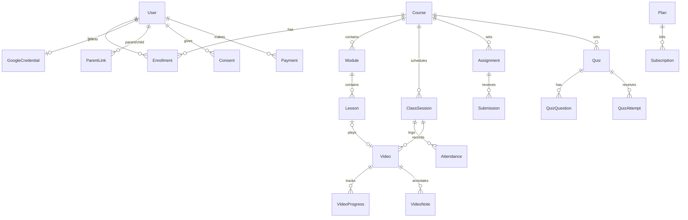

# E-learner — Phase 1 spec (deliverables 1–5)

**Decisions locked from Q&A:** <500 students · school has Google Workspace with Meet recording · paid courses + subscriptions (Razorpay) · K-12, so minors are in scope.

**What that changes from the default brief**

| Default              | Decision                                                 | Why                                                                                                                                                                          |
| -------------------- | -------------------------------------------------------- | ---------------------------------------------------------------------------------------------------------------------------------------------------------------------------- |
| NestJS backend       | **Next.js route handlers + one separate worker process** | One codebase and one deploy at this scale. The worker is a separate process only because ffmpeg and long jobs can't run on serverless.                                       |
| JWT sessions         | **Database sessions (Better Auth + Prisma adapter)**     | Admins and parents must be able to revoke a minor's session instantly. A JWT can't be revoked before it expires.                                                             |
| S3 + CloudFront      | **Cloudflare R2 + Cloudflare CDN**                       | S3-compatible API with zero egress fees, and video is egress-heavy.                                                                                                          |
| Public OAuth app     | **"Internal" OAuth app** in the school's Workspace       | No Google verification or CASA assessment for restricted Drive scopes. The trade-off: only school accounts can use Google features. Parents sign in with email and password. |
| Parent role optional | **Parent role in MVP**                                   | DPDP Act s.9 requires verifiable parental consent before processing a child's data. Parents give it.                                                                         |

---

## 1. Product requirements and user stories

**Goal:** One place where a school's teachers run live classes on Google Meet, and every class becomes a watchable, organized lesson automatically.

**Success metrics (first term):** ≥90% of live classes have a recording attached within 2 h · ≥70% weekly active students · <1% failed uploads · zero access to a video by a non-enrolled user.

### User stories (MVP)

**Student**

- S1. Sign in with my school Google account and see today's classes, pending work and progress.
- S2. Get a **Join** button 10 min before class, plus reminders 24 h and 15 min before.
- S3. Watch the recording of any class I'm enrolled in, at any speed, resuming where I stopped.
- S4. Add timestamped notes and bookmarks while watching.
- S5. Submit assignments (file or text) and take timed MCQ quizzes, seeing auto-graded scores.
- S6. See my courses in a month/week/day calendar and add them to my Google Calendar.

**Teacher**

- T1. Schedule a single or recurring class. The app creates the Calendar event and Meet link and invites enrolled students.
- T2. Drag a class to reschedule. Students' invites update.
- T3. Have Meet recordings attach to the right lesson automatically, or upload my own video (up to 4 GB, resumable).
- T4. See attendance per class, auto-filled from Meet, and override it manually.
- T5. Create assignments and quizzes, grade them with feedback, and see who hasn't submitted.

**Parent (read-only)**

- P1. Give verifiable consent for my child's account. Without it the account stays inactive.
- P2. See my child's attendance, grades and upcoming classes. Withdraw consent or request deletion.

**Admin**

- A1. Manage users and roles, bulk-import students from CSV, enroll them into courses.
- A2. Manage courses, plans, coupons. See usage stats and export attendance and grade reports (CSV).
- A3. View the audit log and process data-erasure requests.

### Out of scope for MVP (v2)

Transcripts and AI summaries · discussion threads and doubts · certificates · WhatsApp/SMS · Hindi/Marathi copy (i18n plumbing ships in MVP, translations later) · offline PWA · LiveKit fallback provider · native apps.

---

## 2. Architecture and data model

The architecture diagram is on the canvas (**System architecture** artboard).

**Request paths**

- **Pages and API:** Browser → Cloudflare → Next.js (Vercel). Each route handler runs `requireRole()` and `assertCanAccess(resource)` before touching Prisma.
- **Scheduling (synchronous):** `POST /api/classes` → Calendar `events.insert` with `conferenceDataVersion=1` → Meet link is stored → `reminder` jobs are enqueued with delays (−24 h, −15 min).
- **Recording sync (asynchronous):** a repeatable job runs every 10 min and picks classes that ended more than 15 min ago and have no recording yet. It calls Meet REST `conferenceRecords.list` (filtered by meeting code), then `recordings.list` and reads `driveDestination.file`. It then streams the Drive file into R2 and enqueues a `transcode` job. Retries back off up to 24 h, then the teacher is flagged "upload manually".
- **Upload:** the browser gets presigned R2 multipart part URLs (16 MB parts) → `complete` → `transcode` job → ffmpeg produces HLS (360p and 720p, 6 s segments) and a thumbnail → status `READY`.
- **Playback:** `GET /api/videos/:id/master.m3u8` checks enrollment, then rewrites the playlists with short-lived presigned segment URLs. Video is never public.

**ER overview** (the full schema is in `prisma/schema.prisma` and validates)



---

## 3. Google integration

**Scopes**, requested incrementally. Teachers are asked for the API scopes only when they first schedule a class.

| Scope                                                     | Who      | Used for                                                                    |
| --------------------------------------------------------- | -------- | --------------------------------------------------------------------------- |
| `openid email profile`                                    | everyone | Sign-in                                                                     |
| `https://www.googleapis.com/auth/calendar.events`         | teacher  | Create, update and delete class events with a Meet link                     |
| `https://www.googleapis.com/auth/meetings.space.readonly` | teacher  | `conferenceRecords`, participants (attendance), recordings                  |
| `https://www.googleapis.com/auth/drive.meet.readonly`     | teacher  | Download only the Drive files Meet created (narrower than `drive.readonly`) |

> `meetings.space.created` only covers spaces your app created through the Meet API. Meets created through Calendar `conferenceData` aren't covered, so we need `meetings.space.readonly`.

**Consent screen:** user type **Internal**, the app logo, a privacy policy URL and authorized domains. Internal apps skip Google's app verification. If you later sell to other schools, switch to External. `meetings.space.readonly` and the Drive scopes then require verification, and `drive.*` requires a CASA security assessment. Budget 4–8 weeks for that.

**Recording prerequisites:** the teacher's Workspace edition must allow recording (Education Plus or Teaching & Learning add-on, Business Standard or higher), and an admin must turn recording on for the teachers' OU. Recordings save to the organizer's Drive, so the teacher who schedules the class must be the one who hosts it.

**Fallback when recording is off or fails:** manual upload is always available. The `ClassSession.autoAttachRecording` flag and a per-tenant `videoProvider` setting leave room for LiveKit in v2.

**Tokens:** refresh tokens are encrypted with AES-256-GCM (key from `TOKEN_ENC_KEY`, rotated by key ID). On `invalid_grant`, mark the credential revoked and ask the teacher to reconnect.

**Quotas:** retry on `403 rateLimitExceeded`, `429` and `5xx` with exponential backoff and jitter (max 5 tries). The BullMQ limiter caps Google calls at 5 per second per teacher.

**Push notifications:** Calendar `events.watch` per teacher catches edits made directly in Google Calendar. Channels are renewed daily by a cron job (they expire). Incremental `syncToken` handles the diff. The Meet "recording ready" event via the Workspace Events API is a v2 replacement for polling.

**Attendance:** `conferenceRecords.participants.list` returns `signedinUser.user = users/{id}`, which maps to `Account.providerAccountId` (the Google `sub`). `earliestStartTime` and `latestEndTime` give the duration. Present means ≥50% of the class length (configurable). Anonymous or phone dial-ins go to the teacher's manual list.

---

## 4. Security and compliance

- **RBAC:** `requireRole()` checks the route, and `assertCanAccess()` checks ownership and enrollment on every resource. There is no client-trusted role. All Prisma queries for students are scoped by `userId`.
- **Input:** Zod on every handler. Bodies are capped at 1 MB (uploads go straight to R2). Markdown is rendered with `rehype-sanitize`. A strict CSP is set.
- **CSRF:** Auth.js double-submit token for auth routes. API mutations require `SameSite=Lax` cookies plus an `Origin` header check.
- **Rate limits:** Upstash Ratelimit. Login and reset: 5/min/IP. API: 120/min/user. Upload init: 10/h.
- **Video:** private R2 bucket, presigned URLs (TTL = duration + 30 min), and no direct bucket listing.
- **Webhooks:** Razorpay HMAC verification with `WebhookEvent.id` for idempotency. Google channel token is verified on every push.
- **Audit:** `AuditLog` covers role changes, grade edits, deletions, consent changes and video access denials.
- **Backups:** Neon point-in-time restore (7 days) plus a weekly `pg_dump` to a separate R2 bucket (encrypted, 90-day retention).
- **DPDP Act 2023 (minors):** verifiable parental consent before activation (parent email OTP plus declaration, logged in `Consent`). No behavioural tracking or targeted ads for under-18s. No third-party analytics on student pages. Data minimisation (DOB is stored only to compute `isMinor`). Erasure on request: soft-delete, then a hard purge job after 30 days, including R2 objects. A grievance officer contact goes in the footer.
- **Recording consent:** students and parents accept the recording notice at onboarding (`ConsentType.RECORDING`).
- **COPPA:** only relevant if you onboard US children. Same consent flow. **GDPR:** relevant only for EU students.
- _Not legal advice: have counsel review the consent flow and privacy notice before launch._

---

## 5. API endpoints (REST, `/api/v1`, OpenAPI at `/api/docs`)

| Area          | Endpoint                                                                                                                                                                                                                                   | Roles                                               |
| ------------- | ------------------------------------------------------------------------------------------------------------------------------------------------------------------------------------------------------------------------------------------ | --------------------------------------------------- |
| Auth          | `POST /auth/register` · `POST /auth/verify-email` · `POST /auth/forgot` · `POST /auth/reset` · `/api/auth/*` (Auth.js)                                                                                                                     | public                                              |
| Consent       | `POST /consents/parent/request` · `POST /consents/parent/verify` · `DELETE /consents/:id`                                                                                                                                                  | parent, student                                     |
| Google        | `GET /google/connect` (incremental scopes) · `DELETE /google/connect` · `POST /google/webhooks/calendar`                                                                                                                                   | teacher / Google                                    |
| Users         | `GET /me` · `PATCH /me` · `GET /users` · `POST /users/import` (CSV) · `PATCH /users/:id/role` · `DELETE /users/:id`                                                                                                                        | admin (except `/me`)                                |
| Courses       | `GET/POST /courses` · `GET/PATCH/DELETE /courses/:id` · `POST /courses/:id/enrollments` · `DELETE /courses/:id/enrollments/:userId`                                                                                                        | teacher (own), admin; students see enrolled courses |
| Content       | `POST /courses/:id/modules` · `PATCH /modules/:id` · `POST /modules/:id/lessons` · `PATCH/DELETE /lessons/:id` · `POST /lessons/:id/attachments`                                                                                           | teacher                                             |
| Classes       | `GET /classes?from&to&courseId` · `POST /classes` · `PATCH /classes/:id` (reschedule, `scope=this\|following`) · `DELETE /classes/:id` · `GET /classes/:id/join` (time-gated redirect) · `GET /classes.ics`                                | teacher writes, enrolled read                       |
| Attendance    | `GET /classes/:id/attendance` · `PUT /classes/:id/attendance/:userId` · `POST /classes/:id/attendance/sync`                                                                                                                                | teacher                                             |
| Videos        | `POST /videos/uploads` (init multipart) · `POST /videos/uploads/:id/parts` (presign) · `POST /videos/uploads/:id/complete` · `GET /videos/:id` · `GET /videos/:id/master.m3u8` · `PUT /videos/:id/progress` · `GET/POST /videos/:id/notes` | teacher upload, enrolled view                       |
| Assignments   | `GET/POST /courses/:id/assignments` · `PATCH /assignments/:id` · `PUT /assignments/:id/submission` · `GET /assignments/:id/submissions` · `PATCH /submissions/:id/grade`                                                                   | mixed                                               |
| Quizzes       | `POST /courses/:id/quizzes` · `POST /quizzes/:id/attempts` · `PUT /attempts/:id` (submit, auto-grade)                                                                                                                                      | mixed                                               |
| Notifications | `GET /notifications` · `POST /notifications/read`                                                                                                                                                                                          | self                                                |
| Payments      | `GET /plans` · `POST /checkout/order` · `POST /checkout/subscription` · `POST /coupons/validate` · `POST /webhooks/razorpay`                                                                                                               | buyer / Razorpay                                    |
| Dashboards    | `GET /dashboard/student` · `/teacher` · `/parent` · `/admin/stats` · `GET /reports/attendance.csv` · `/reports/grades.csv`                                                                                                                 | role-specific                                       |
| Audit         | `GET /audit?targetType&targetId`                                                                                                                                                                                                           | admin                                               |

---

## 6. Folder structure

```
e-learner/
├─ apps/
│  ├─ web/                         # Next.js 15 (App Router)
│  │  ├─ app/
│  │  │  ├─ [locale]/(auth)/sign-in|register|reset/
│  │  │  ├─ [locale]/(app)/dashboard|classes|calendar|library|assignments|messages|admin/
│  │  │  ├─ [locale]/(app)/library/[videoId]/page.tsx
│  │  │  └─ api/v1/**/route.ts     # REST handlers
│  │  ├─ components/ui/            # shadcn/ui
│  │  ├─ components/{calendar,player,class-card,...}
│  │  ├─ lib/{auth.ts,rbac.ts,google/,r2.ts,crypto.ts,ratelimit.ts,queue.ts}
│  │  ├─ messages/{en,hi,mr}.json  # next-intl
│  │  └─ middleware.ts             # locale + auth gate
│  └─ worker/                      # Node + BullMQ + ffmpeg (Docker)
│     ├─ src/jobs/{reminders,recording-sync,transcode,watch-renew,purge}.ts
│     └─ Dockerfile
├─ packages/
│  ├─ db/   (prisma/schema.prisma, migrations, seed.ts, client export)
│  ├─ core/ (zod schemas, rbac rules, shared types)
│  └─ config/ (eslint, tsconfig, tailwind preset with design tokens)
├─ e2e/ (Playwright)
├─ .github/workflows/{ci.yml,deploy.yml}
├─ docker-compose.yml   # postgres, redis, minio (R2 stand-in) for local dev
└─ turbo.json / pnpm-workspace.yaml
```

---

## 7. Implementation plan

Estimates assume one experienced full-stack dev and a part-time designer.

| Phase               | Scope                                                                                                                                                                                                                              | Est.          |
| ------------------- | ---------------------------------------------------------------------------------------------------------------------------------------------------------------------------------------------------------------------------------- | ------------- |
| **0. Foundation**   | Monorepo, CI, docker-compose, Prisma and migrations, design tokens → Tailwind, shadcn setup, Sentry                                                                                                                                | 1 wk          |
| **1. Identity**     | Auth.js (Google + credentials), email verification, reset, RBAC, parent linking, DPDP consent flow, admin user CSV import                                                                                                          | 2 wk          |
| **2. Courses**      | Courses, modules, lessons, attachments, enrollment, student and teacher course pages                                                                                                                                               | 1.5 wk        |
| **3. Live classes** | Google connect (incremental scopes), schedule, recurring and reschedule via Calendar API, Join gating, FullCalendar views, .ics, reminders (BullMQ + Resend), Calendar push sync                                                   | 2 wk          |
| **4. Video**        | Multipart upload, ffmpeg HLS worker, gated playlist, player (hls.js, speed, resume, notes), Meet recording sync, attendance sync                                                                                                   | 2.5 wk        |
| **5. Work**         | Assignments, submissions, grading, MCQ quizzes with auto-grade                                                                                                                                                                     | 1.5 wk        |
| **6. Dashboards**   | Student, teacher, parent, admin dashboards, in-app notifications, CSV reports                                                                                                                                                      | 1.5 wk        |
| **7. Payments**     | Razorpay orders and subscriptions, coupons, trial, webhook idempotency, access gating                                                                                                                                              | 1.5 wk        |
| **8. Hardening**    | Security review (OWASP ASVS L2 checklist), a11y audit, load test (k6, 500 concurrent), backups drill, pilot with one class                                                                                                         | 1.5 wk        |
| **MVP total**       |                                                                                                                                                                                                                                    | **≈15 weeks** |
| **v2**              | Transcripts and AI summaries (Meet transcripts first, Whisper for uploads), discussion and doubts, certificates (PDF), WhatsApp via MSG91, Hindi/Marathi copy, PWA offline, LiveKit fallback, Workspace Events push for recordings | +8–10 wk      |

**Next (Phase 2 of this conversation):** working code for auth, Meet scheduling, recording sync, video upload and the calendar page. After that: deployment guide, env vars and test strategy.
