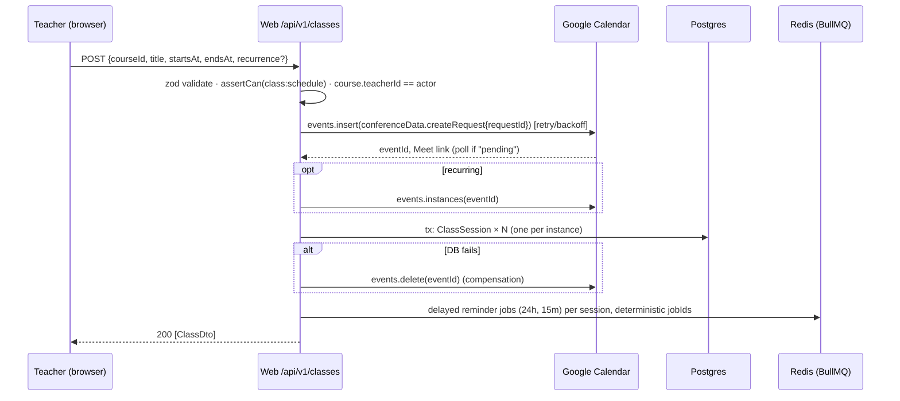
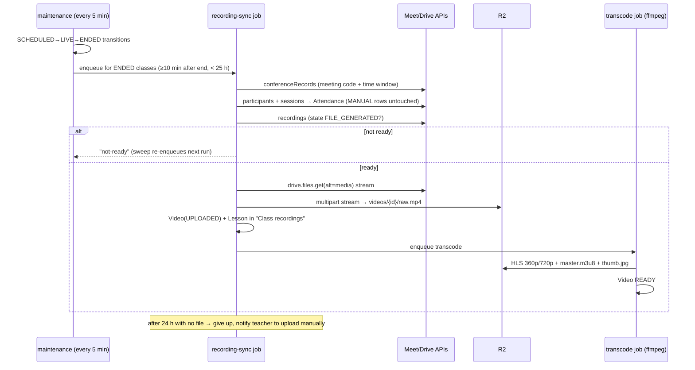

# E-learner — System Design

> Status: **reflects the code at commit `d3dfb86`**. Update this file in the same PR as any change to
> components, data flow, queues or storage layout. Decisions with lasting trade-offs get an ADR in `docs/adr/`.

## 1. Requirements

### Functional (MVP)

| #   | Requirement                                                                    | Where                                                      |
| --- | ------------------------------------------------------------------------------ | ---------------------------------------------------------- |
| F1  | Email/password + Google sign-in, verification, reset, roles                    | `apps/web/src/lib/auth.ts`                                 |
| F2  | Teacher schedules single/weekly classes → Calendar event + Meet link + invites | `server/services/classes.ts` → `packages/google`           |
| F3  | Students join from 10 min before start (server-enforced)                       | `getJoinUrl()`, `/api/v1/classes/:id/join`                 |
| F4  | Reminders 24 h (+parents) and 15 min before, email + in-app                    | `apps/worker/src/jobs/reminder.ts`                         |
| F5  | Meet recordings auto-imported, transcoded to HLS, attached as lessons          | `jobs/recording-sync.ts`, `jobs/transcode.ts`              |
| F6  | Manual resumable uploads up to 4 GB                                            | `server/services/videos.ts`, `library/upload/multipart.ts` |
| F7  | Playback only for enrolled users; resume position; watch time                  | `getHlsFile()`, `saveProgress()`                           |
| F8  | Attendance from Meet participant sessions; manual override wins                | `syncAttendance()`                                         |
| F9  | Calendar views, drag-reschedule, .ics export, two-way Google sync              | `calendar/class-calendar.tsx`, `jobs/calendar-sync.ts`     |
| F10 | Learner progress: course cards, resume card, daily watch time, streak, month   | `server/services/learning.ts`, `docs/ui.md`                |

### Non-functional

| Attribute    | Target                                                                     | Rationale                                                  |
| ------------ | -------------------------------------------------------------------------- | ---------------------------------------------------------- |
| Scale        | ≤ 500 students, ~20 teachers, 1 school (single tenant)                     | Q&A answer                                                 |
| Availability | 99.5 % during school hours (06:00–22:00 IST); planned maintenance at night | A missed live class is the worst failure; nights are quiet |
| Latency      | API p95 < 300 ms; join redirect < 500 ms; first video frame < 3 s          | Class-start burst must feel instant                        |
| Freshness    | Recording in Library ≤ 2 h after class (p90)                               | Meet needs minutes to hours to produce files               |
| Durability   | DB RPO ≤ 5 min, RTO ≤ 1 h; media RPO 0 (object storage)                    | Grades/attendance are records                              |
| Security     | OWASP ASVS L2; no public media URLs; secrets encrypted at rest             | K-12 data, paid content                                    |
| Compliance   | India DPDP Act 2023: verifiable parental consent, erasure ≤ 30 days        | Minors                                                     |
| Cost         | Small fixed monthly cost; no egress fees on video                          | School budget                                              |

### Constraints

One or two developers; Google Workspace (with recording) already in place; India-first (Asia/Kolkata, Hindi/Marathi later).

## 2. High-level design

```
                       ┌──────────────────────── Google Workspace ─────────────────────────┐
                       │  Calendar API      Meet REST API (records,      Drive API          │
                       │  (events, watch)   participants, recordings)    (drive.meet.ro)    │
                       └────▲─────────┬────────────────▲─────────────────────▲─────────────┘
              create/patch event │    │ push (webhook)  │ poll after class     │ download
                       ┌────────┴────▼───┐               │                     │
 Browser / PWA ──HTTPS─►  Next.js web     │──enqueue──►  Redis (BullMQ)  ──►  Worker (Docker, ffmpeg)
 (students,      ◄──────  UI + /api/v1    │              queues + rate-limit     │  reminders · recording-sync
  teachers,       RSC/JSON│ Better Auth    │                                      │  transcode · calendar-sync
  parents)        │       └──┬──────────┬──┘                                      │  maintenance (cron)
                  │          │ Prisma   │ presign                                 │
                  │          ▼          ▼                                         ▼
                  │     PostgreSQL   Cloudflare R2  ◄──── HLS segments, thumbs, raw uploads ────┘
                  │     (Neon)       (private bucket)
                  └── direct multipart PUT / HLS segment GET (presigned, short-lived) ──┘
                                     SMTP provider ◄── worker + web (verify/reset/reminders)
```

**Component responsibilities**

| Component         | Owns                                                                              | Never does                                              |
| ----------------- | --------------------------------------------------------------------------------- | ------------------------------------------------------- |
| `apps/web`        | Auth, RBAC, request validation, synchronous Google calls (scheduling), presigning | Long work (> a few seconds), ffmpeg, polling Google     |
| `apps/worker`     | Anything slow, scheduled or retried                                               | Serve user traffic                                      |
| `packages/core`   | Pure rules (RBAC, time windows, tz, schemas, HLS rewrite, attendance math)        | I/O                                                     |
| `packages/google` | Google API calls, retries, token refresh, encrypted grant storage                 | Business decisions                                      |
| `packages/queue`  | Queue names + payload schemas (the web↔worker contract)                          | Job logic                                               |
| PostgreSQL        | Source of truth for everything except media bytes                                 | —                                                       |
| Redis             | Job queues, delayed reminders, rate-limit counters                                | Source of truth (everything is re-derivable — see §4.4) |
| R2                | Media bytes                                                                       | Public access                                           |

### Storage choices

| Data                         | Store                                     | Why                                                                            |
| ---------------------------- | ----------------------------------------- | ------------------------------------------------------------------------------ |
| Relational domain data       | PostgreSQL (Prisma 7)                     | Strong constraints (unique enrollments, attendance per class) and transactions |
| Sessions                     | PostgreSQL                                | Instant revocation; volume is tiny                                             |
| Jobs, delays, counters       | Redis (`noeviction`, AOF on)              | BullMQ requirement; atomic counters                                            |
| Video (raw, HLS), thumbnails | R2                                        | S3 API, zero egress fees                                                       |
| Google refresh tokens        | PostgreSQL, AES-256-GCM, key-id versioned | Needed by background jobs; rotatable (`packages/core/src/crypto.ts`)           |

## 3. Key flows

### 3.1 Schedule a class (F2)



_Ordering rationale:_ Google first because the Meet link is required data; a compensating delete keeps the two
systems consistent without distributed transactions. The `requestId` makes Meet creation idempotent on retry.

### 3.2 Recording → Library (F5, F8)



### 3.3 Upload (F6) and playback (F7)

- **Upload:** `POST /videos/uploads` creates `Video(PENDING_UPLOAD)` + S3 multipart → browser PUTs 16 MiB parts directly
  to R2 (4 in parallel, 3 retries each, fresh URL on retry) → `complete` verifies size via HEAD → `transcode` job.
  Abandoned uploads are aborted after 24 h. The app server never proxies video bytes.
- **Playback:** the player requests `/api/v1/videos/:id/hls/master.m3u8`. The API checks enrollment, reads the
  playlist from R2 and rewrites it: child playlists route back through the API, segments become presigned GETs
  (TTL = max(1 h, 2 × duration + 30 min)). Path traversal is rejected in `resolveHlsPath`.

## 4. Deep dive

### 4.1 Data model (essentials)

```
User ─< Enrollment >─ Course ─< Module ─< Lesson ──o Video
 │                      │                           │
 ├─< ParentLink >─ User ├─< ClassSession ─< Attendance
 ├─o GoogleCredential   │       └──< Video (Meet recordings)
 ├─< Account/Session    └─< Assignment/Quiz …
 ├─< VideoProgress >─ Video        (per video: position, watched seconds, completed)
 ├─< LearningDay                   (per learner per local day: watched seconds)
 └─< Notification (dedupeKey unique) · AuditLog · WatchChannel
```

`LearningDay.day` is the learner's own calendar date (`User.timezone`), written by `saveProgress()` from the
same capped `watchedDeltaSeconds` as `VideoProgress`. Streaks and the monthly activity calendar read only this
table (one indexed range scan per page view), never the raw progress beacons.

Invariants enforced by the database, not just code: one enrollment per (user, course); one attendance per
(class, user); one ClassSession per Google event instance (`@@unique([googleCalendarId, googleEventId])`);
one Video per Drive file (`driveFileId @unique`); one notification per `dedupeKey`.

### 4.2 API design

REST under `/api/v1`, JSON `{ data }` on success, RFC 9457 `application/problem+json` with a stable `code` on error.
Every handler goes through `route()` (auth → role gate → same-origin check → rate limit → zod → service).
Endpoint list: `docs/SPEC.md` §5. Breaking changes ship as `/api/v2` routes; v1 stays until clients move.

### 4.3 Caching

Deliberately minimal at this scale: the RSC payload is per-user and uncached (`force-dynamic`, required for the CSP
nonce). Fonts and JS chunks are immutable and CDN-cached. Playlists are `no-store` (they contain short-lived
signatures). See §6 for when to add caching.

### 4.4 Queues

| Queue            | Producer          | Concurrency             | Retries              | Idempotency key                                                 |
| ---------------- | ----------------- | ----------------------- | -------------------- | --------------------------------------------------------------- |
| `reminders`      | web (schedule)    | 10                      | 5, exp. 30 s         | `reminder_{kind}_{class}_{startsMs}` + `Notification.dedupeKey` |
| `recording-sync` | maintenance sweep | 2, ≤ 10/s               | sweep re-enqueues    | `recsync_{class}`; `driveFileId` unique                         |
| `transcode`      | upload, rec-sync  | `TRANSCODE_CONCURRENCY` | 3; FAILED after last | `transcode_{video}`; skip if READY                              |
| `calendar-sync`  | Google webhook    | 4                       | 5                    | `calsync_{user}` (5 s debounce)                                 |
| `maintenance`    | job schedulers    | 1                       | 5                    | scheduler id                                                    |

Payloads are zod-validated on the consumer. Stale work self-cancels (a reminder whose `startsAtMs` no longer
matches the class does nothing).

### 4.5 Error handling and retries

| Failure                           | Behaviour                                                                                                            |
| --------------------------------- | -------------------------------------------------------------------------------------------------------------------- |
| Google 429 / 5xx / rate-limit 403 | Exponential backoff with full jitter, 5 tries (`packages/google/src/retry.ts`)                                       |
| Google `invalid_grant`            | Grant marked revoked → `GOOGLE_RECONNECT_REQUIRED` (409) → UI shows "Reconnect Google"; worker notifies teacher once |
| DB write fails after Google call  | Compensating `events.delete`                                                                                         |
| Part upload fails                 | Per-part retry with a fresh presigned URL                                                                            |
| Transcode fails                   | BullMQ retries 3×, then `Video.status = FAILED` + error stored                                                       |
| Unexpected exception              | 500 problem+json with `requestId`, full error logged, no internals leaked                                            |

## 5. Scale and reliability

### 5.1 Load estimation (assumptions stated; revisit after pilot)

| Quantity                  | Assumption                                                     | Result                                                                             |
| ------------------------- | -------------------------------------------------------------- | ---------------------------------------------------------------------------------- |
| Live classes              | 25 sections × 5/week × 45 min                                  | ~25 classes/day, ~19 h of video/day                                                |
| Class-start burst         | 31 students click Join within ~2 min, 5 classes start together | ~2 req/s — trivial                                                                 |
| HLS size per class        | 360p (0.9 Mbps) + 720p (2.9 Mbps) × 2 700 s                    | ~1.3 GB/class → **~32 GB/school day**                                              |
| Raw size per class        | Meet MP4 ≈ 0.3–0.5 GB                                          | ~10 GB/day                                                                         |
| Media per year (200 days) | HLS + raw                                                      | **~6.4 TB HLS + ~2 TB raw** — dominant cost                                        |
| Peak concurrent viewers   | 30 % of students in the evening, 720p                          | 150 × 2.9 Mbps ≈ **435 Mbps** from storage                                         |
| Progress beacons          | 150 viewers / 15 s                                             | ~10 writes/s to Postgres                                                           |
| Transcode CPU             | `veryfast` 2-rendition ladder ≈ 1× real time per 2 vCPU        | ~19 CPU-hours/day → 1 worker (2–4 vCPU) keeps up; afternoon queue drains in ~2–3 h |
| Database                  | Rows, not bytes                                                | < 10 GB/year                                                                       |

**Conclusion:** compute and database are small. Media storage and serving are what grow; design effort goes there (§6).

### 5.2 Scaling model

- **Web:** stateless, scales horizontally (Vercel functions). All shared state lives in Postgres/Redis.
- **Worker:** stateless. Add replicas; BullMQ distributes jobs and schedulers are deduplicated by id. Split transcode
  into its own deployment (bigger CPU) once queue wait for `transcode` exceeds 1 h.
- **Postgres:** single primary with connection pooling. Read replica only if dashboards become heavy.

### 5.3 Failure modes

| Dependency down | Impact                                                       | Mitigation / recovery                                     |
| --------------- | ------------------------------------------------------------ | --------------------------------------------------------- |
| Postgres        | Total outage                                                 | Managed HA + PITR (RPO ≤ 5 min); restore runbook          |
| Redis           | Rate limiting off (fails open, logged); jobs paused          | AOF persistence; reminders rebuilt by reconciliation (G4) |
| Worker          | No reminders/recordings until restart; nothing lost          | Health check `/healthz`; sweep catches up on restart      |
| R2              | Playback/upload down; rest of app works                      | Provider SLA; nothing to fail over to at this scale       |
| Google APIs     | Can't schedule; existing Meet links still work; sync delayed | Retries; 24 h recording window absorbs outages            |
| SMTP            | Emails delayed; in-app notifications still created           | Per-recipient failure isolation; retries                  |

### 5.4 Monitoring and alerting

| Signal                                            | Alert when                           | Severity                                |
| ------------------------------------------------- | ------------------------------------ | --------------------------------------- |
| `/api/health/ready` (web) and `/healthz` (worker) | 2 consecutive failures (1-min probe) | Page                                    |
| API 5xx rate                                      | > 2 % over 5 min (school hours)      | Page                                    |
| Join redirect p95                                 | > 1 s over 5 min                     | Ticket                                  |
| `transcode` oldest waiting job                    | > 2 h                                | Ticket                                  |
| Failed jobs (final attempt), any queue            | > 0 in 15 min                        | Ticket                                  |
| Classes ENDED > 3 h with no recording             | > 3 per day                          | Ticket (often a Workspace policy issue) |
| Google `GOOGLE_RECONNECT_REQUIRED` count          | any                                  | Ticket (contact teacher)                |

Logs are structured JSON (pino) with `requestId`/`jobId`. Errors go to Sentry when `SENTRY_DSN` is set.

## 6. Trade-offs

| Decision            | Chosen                                       | Alternative                      | Why / cost of the choice                                                                               |
| ------------------- | -------------------------------------------- | -------------------------------- | ------------------------------------------------------------------------------------------------------ |
| Backend shape       | Next.js route handlers + 1 worker            | NestJS service                   | One deploy, one language, less ceremony. Revisit if a mobile app needs a separately versioned API team |
| Sessions            | DB sessions (Better Auth)                    | JWT                              | Instant revocation for minors; costs one indexed query per request                                     |
| Meet integration    | Calendar `createRequest`                     | Meet API `spaces.create`         | Students get native invites; needs `meetings.space.readonly` instead of `.created`                     |
| Recording detection | Polling sweep (5 min)                        | Workspace Events API push        | No Pub/Sub to run; ~5–15 min extra latency                                                             |
| Recurring classes   | Google event instances → rows                | Expand RRULE ourselves           | Exceptions stay consistent with Google; capped at 200 days / 250 instances                             |
| Playback gating     | API-rewritten playlists + presigned segments | Public CDN, or Cloudflare Stream | Strong access control, no new vendor; segments bypass CDN cache (G2)                                   |
| Transcoding         | Self-run ffmpeg                              | Mux / Cloudflare Stream          | Fixed cost, full control; we own failures and CPU sizing                                               |
| Rendering           | All pages dynamic                            | Static + hash CSP                | Nonce CSP works everywhere; no static-page caching (irrelevant behind login)                           |

## 7. Known gaps (found during this design review)

| ID  | Gap                                                                                          | Risk   | Fix                                                                                                                                 |
| --- | -------------------------------------------------------------------------------------------- | ------ | ----------------------------------------------------------------------------------------------------------------------------------- |
| G1  | ~~Rate limiter failed closed: Redis outage → sign-in and APIs 500~~                          | Fixed  | `consume()` now fails open and logs `rate limiter unavailable` (alert on it); covered by `rate-limit.test.ts`                       |
| G2  | Presigned R2 URLs hit `*.r2.cloudflarestorage.com` directly — **no CDN caching** of segments | Medium | Fine at 435 Mbps peak. At larger scale: R2 custom domain + Cloudflare token auth (WAF/Worker), cache segments                       |
| G3  | Progress beacons write to Postgres on every beacon                                           | Low    | At > ~100 writes/s: buffer in Redis, flush every minute                                                                             |
| G4  | ~~Reminders live only as delayed jobs in Redis; a lost Redis loses future reminders~~        | Fixed  | Maintenance task `reconcile-reminders` (every 15 min) re-adds reminders for classes in the next 48 h; covered by `jobs.int.test.ts` |
| G5  | Attendance assumes Meet `users/{id}` equals the OpenID `sub` stored in `Account.accountId`   | Medium | Verify in the pilot with real accounts; fallback is manual marking                                                                  |
| G6  | ~~Raw uploads are kept forever after transcoding (~2 TB/yr)~~                                | Fixed  | Maintenance task `delete-transcoded-raw` (daily 03:30 IST) deletes the original 30 days after READY                                 |
| G7  | Region placement not pinned (latency + DPDP data location)                                   | Low    | Choose India/nearby regions for Vercel functions, Postgres and R2 location hint; record in an ADR                                   |

## 8. What to revisit as it grows

| Trigger                                | Change                                                                                                     |
| -------------------------------------- | ---------------------------------------------------------------------------------------------------------- |
| > 1 school                             | Multi-tenancy: `schoolId` on every row + row-level security, per-tenant Google config, tenant-aware queues |
| > 2 000 concurrent viewers or > 1 Gbps | Fix G2 (CDN-cached segments) or move delivery to a managed video service                                   |
| `transcode` wait > 1 h regularly       | Separate transcode deployment, larger CPU, or GPU/managed encoding                                         |
| Recording latency complaints           | Workspace Events API (recording `fileGenerated`) instead of polling                                        |
| Native mobile app                      | Versioned public API (OpenAPI-first), token auth, push notifications                                       |
| > ~100 writes/s on progress            | Redis write-behind (G3)                                                                                    |
| Media storage cost becomes material    | G6 lifecycle, drop 720p for older terms, cold storage tier                                                 |
